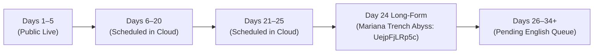
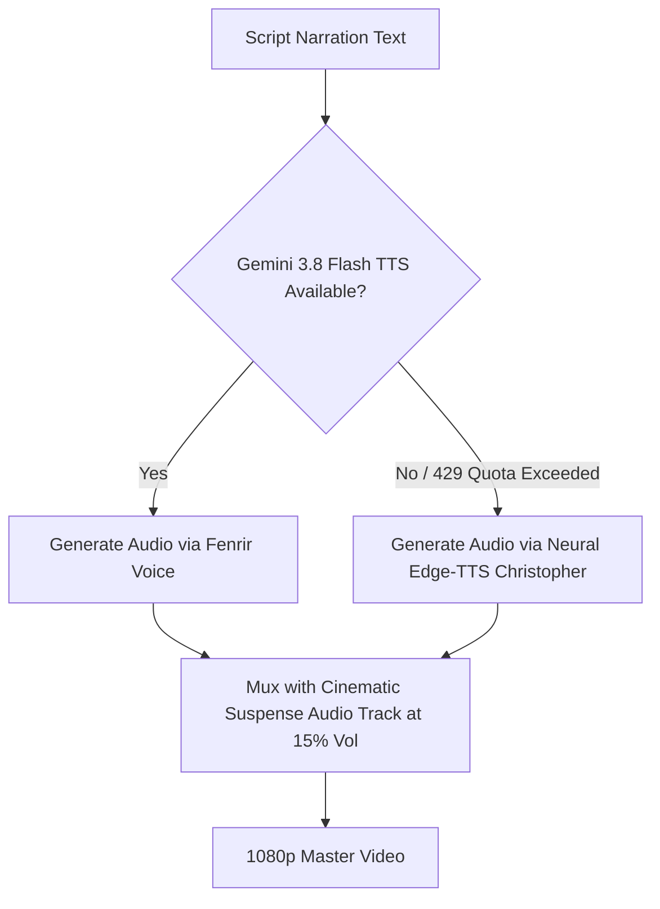
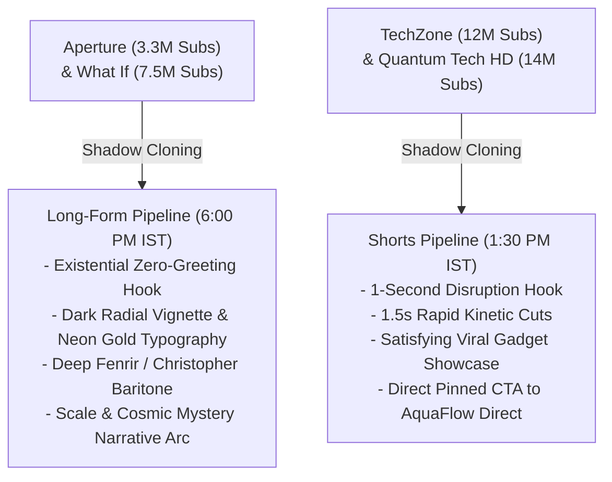
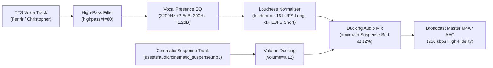

# YouTube Automation Channel Shadow Print & Master Architecture Blueprint

> [!NOTE]
> **Snapshot Date**: October 28, 2026 | **Channel**: `@kannadiga_369` (`P.Kannadiga`) | **Channel ID**: `UC5XlZUywFHuWuWxUYmgK26A`  
> This document and the companion files in `./shadow-print/` represent the complete standalone **Shadow Copy** of the channel, its video/audio assets, content calendars, cloud runners, and e-commerce funnel.

---

## 1. Channel Identity & Live Metadata

| Property | Value |
|---|---|
| **Channel Name** | `P.Kannadiga` |
| **Handle** | `@kannadiga_369` |
| **Channel ID** | `UC5XlZUywFHuWuWxUYmgK26A` |
| **Total Subscribers** | `89` |
| **Total Views** | `95,833` |
| **Live Videos Count** | `49` |
| **Active Target** | `2,000 Subscribers` • `40,000 Watch Hours` • E-Commerce Conversions |
| **Primary Content Language** | **100% English** (Permanent Global Pivot) |
| **Content Archetypes** | **Archetype 2** (Global Mysteries, Cosmic "What If", Ocean Abyss) for Long-Form<br>**Archetype 3** (Viral Inventions & Smart Gadgets) for Shorts |
| **Promoted Dropshipping Store** | **AquaFlow Direct** (`https://latinas-plastic-manitoba-handling.trycloudflare.com/`) |

### Global SEO Keyword Indexing
The channel is indexed in YouTube's recommendation algorithm using the following global search tags:
```text
"World Mysteries" "Unsolved Mysteries" "Science Documentary" "What If" "Aperture" "Thoughty2" "Deep Sea Mysteries" "Ancient Engineering" "Megalithic Wonders" "Viral Inventions" "Smart Gadgets" "Mind Blowing Facts" "Cosmic Mysteries" "Space Documentary" "AquaFlow Direct" "Kannadiga 369"
```

---

## 2. Playlists Taxonomy & IDs

| Playlist Title | Playlist ID | Target Content |
|---|---|---|
| **Cosmic & Deep Ocean Mysteries \| Unsolved Science & What If 🌊🌌** | `PLQYyVHEGEm1M` | Mariana Trench, rogue black holes, JWST anomalies, simulation paradoxes |
| **Viral Inventions & Smart Gadgets \| Mind-Blowing Tech ⚡💡** | `PLeWOUBoNVaPE` | High-converting life-hacks, inventions, gadgets, and store CTA |
| **Ancient Engineering & Megalithic Enigmas 🏛️🗿** | `PLaW6e-JSO_4U` | Great Pyramid muon scan, Antikythera computer, Baalbek megaliths |
| **ಕರ್ನಾಟಕದ ಬೆಚ್ಚಿಬೀಳಿಸುವ ರಹಸ್ಯಗಳು & ಇತಿಹಾಸ** | `PLfeygpKYFwkM` | Legacy regional Karnataka documentaries (Days 1–20) |
| **Science** | `PLoJnGQ7G8wr06V5fIM0X5u9hFchbtsNji` | General scientific curiosity videos |

---

## 3. Complete Video Roster & Cloud Scheduling State (45 Tracked Videos)



### Video Catalog Detail Table

| Day | Type | Video ID | Scheduled / Publish Date | Title / Topic | Privacy Status |
|:---:|:---:|:---:|:---:|:---|:---:|
| **1** | Long-Form | `brMGSd7J8V4` | Published | British Mysteries in Karnataka | Public |
| **2** | Long-Form | `DVw06PqujMs` | Published | Chitradurga 7 Rounds Fort | Public |
| **2** | Short | `KJlnpAEf3kk` | Published | Onake Obavva Legend | Public |
| **3** | Long-Form | `uZ_57yZkjIU` | Published | 57ft Gommateshwara Statue | Public |
| **4** | Long-Form | `49s3LFMrkEw` | Published | Mysore Palace Secret Tunnel | Public |
| **5** | Long-Form | `XBE8AFZ3_yo` | Published | St. Mary's Volcanic Island | Public |
| **6** | Long-Form | `iEzV2ebnn7o` | Oct 27, 6:00 PM IST | Madhugiri Monolith Mystery | Public |
| **6** | Short | `r_VxNeZVuWw` | Oct 27, 1:30 PM IST | Madhugiri Monolith Short | Public |
| **7** | Long-Form | `RTwCJJV6F60` | Oct 28, 6:00 PM IST | Belur Halebidu Architecture | Public |
| **7** | Short | `a3aB_kvLkNY` | Oct 28, 1:30 PM IST | Belur Halebidu Short | Public |
| **8** | Long-Form | `ZVKKi3T1W2U` | Oct 29, 6:00 PM IST | Kavala Caves Underground | Scheduled |
| **8** | Short | `ESItsjKDlg8` | Oct 29, 1:30 PM IST | Kavala Caves Short | Scheduled |
| **9** | Long-Form | `j-WoNJgh4rk` | Oct 30, 6:00 PM IST | Kempegowda 4 Watchtowers | Scheduled |
| **9** | Short | `IjdUtsoY5uo` | Oct 30, 1:30 PM IST | Kempegowda Watchtowers Short | Scheduled |
| **10** | Long-Form | `jWpepquY5qc` | Oct 31, 6:00 PM IST | Bidar Fort Underground Karez | Scheduled |
| **10** | Short | `rya9AlXTBz8` | Oct 31, 1:30 PM IST | Bidar Karez Short | Scheduled |
| **11** | Long-Form | `OxYnKqFzfIA` | Nov 1, 6:00 PM IST | Barkur 365 Temples Ghost City | Scheduled |
| **11** | Short | `wzLxpY_olfo` | Nov 1, 1:30 PM IST | Barkur Ghost City Short | Scheduled |
| **12** | Long-Form | `KB60L7rTA2w` | Nov 2, 6:00 PM IST | Melukote Vairamudi Crown | Scheduled |
| **12** | Short | `UVld0k63re4` | Nov 2, 1:30 PM IST | Melukote Crown Short | Scheduled |
| **13** | Long-Form | `HjGUgZP-P6E` | Nov 3, 6:00 PM IST | Badami Rock Caves | Scheduled |
| **13** | Short | `yLoHCx1rGX4` | Nov 3, 1:30 PM IST | Badami Caves Short | Scheduled |
| **14** | Long-Form | `6v-sPBtxbQY` | Nov 4, 6:00 PM IST | Jog Falls Sharavathi Gorge | Scheduled |
| **14** | Short | `nDShjWpdfdE` | Nov 4, 1:30 PM IST | Jog Falls Short | Scheduled |
| **15** | Long-Form | `kNDz7pNtiz4` | Nov 5, 6:00 PM IST | Kittur Rani Chennamma Guerrilla | Scheduled |
| **15** | Short | `cYjbqVNm-PU` | Nov 5, 1:30 PM IST | Rani Chennamma Short | Scheduled |
| **16** | Long-Form | `8Oagk-3XJ2A` | Nov 6, 6:00 PM IST | Banavasi Madhukeshwara Temple | Scheduled |
| **16** | Short | `uOaQbjcbKqY` | Nov 6, 1:30 PM IST | Banavasi Temple Short | Scheduled |
| **17** | Long-Form | `yJFLJQjpYf4` | Nov 7, 6:00 PM IST | Sringeri Vidyashankara Zodiac | Scheduled |
| **17** | Short | `i7REWVKCrCc` | Nov 7, 1:30 PM IST | Sringeri Zodiac Short | Scheduled |
| **18** | Long-Form | `pt1S75KbL3Q` | Nov 8, 6:00 PM IST | Madikeri Fort & Kodagu Warriors | Scheduled |
| **18** | Short | `fJH8p80pz9I` | Nov 8, 1:30 PM IST | Madikeri Fort Short | Scheduled |
| **19** | Long-Form | `OORTcvXBu5g` | Nov 9, 6:00 PM IST | Belagavi Fort Kamal Basadi | Scheduled |
| **19** | Short | `bUWSKks0p60` | Nov 9, 1:30 PM IST | Belagavi Fort Short | Scheduled |
| **20** | Long-Form | `7p9BMrosjVk` | Nov 10, 6:00 PM IST | Aihole 120 Stone Temples | Scheduled |
| **20** | Short | `ZxZJ6pGdFiA` | Nov 10, 1:30 PM IST | Aihole Temples Short | Scheduled |
| **21** | Long-Form | `EcFWpnTrVFc` | Nov 11, 6:00 PM IST | Moodabidri 1000 Pillars Basadi | Scheduled |
| **21** | Short | `AsNegPVIr90` | Nov 11, 1:30 PM IST | Moodabidri Short | Scheduled |
| **22** | Long-Form | `GM1y_MkFYUo` | Nov 12, 6:00 PM IST | Agumbe Rainforest & King Cobras | Scheduled |
| **22** | Short | `7jwJZ0rS5oo` | Nov 12, 1:30 PM IST | Agumbe Short | Scheduled |
| **23** | Long-Form | `wafvpqk-N9A` | Nov 13, 6:00 PM IST | Nandi Hills Tipu's Drop Cliff | Scheduled |
| **23** | Short | `zH-o_Q_xIeU` | Nov 13, 1:30 PM IST | Nandi Hills Short | Scheduled |
| **24** | **Long-Form** | `UejpFjLRp5c` | **Nov 14, 6:00 PM IST** | **The Terrifying Secrets at the Bottom of the Mariana Trench! 😱🌊** | **Scheduled (100% English)** |
| **25** | Long-Form | `tliSCb3WOXQ` | Nov 15, 6:00 PM IST | Savandurga Monolith Fort | Scheduled |
| **25** | Short | `DZVNrCLAG_Q` | Nov 15, 1:30 PM IST | Savandurga Short | Scheduled |

---

## 4. Audio Engine & Dual-Tier Fallback Specification



1. **Primary TTS Model**:
   - `gemini-3.8-flash-tts`
   - Voice: `Fenrir` (Deep, dramatic, documentary baritone)
   - Sample Rate: 24,000 Hz PCM muxed to 192kbps MP3
2. **Instant Unlimited Fallback TTS**:
   - `python -m edge_tts --voice en-US-ChristopherNeural`
   - Zero-cost, unlimited bandwidth, zero daily rate limits
   - Seamlessly takes over whenever Gemini free-tier daily cap is reached
3. **Background Soundtrack Track**:
   - `assets/audio/cinematic_suspense.mp3` (Dramatic tension drone ducked to 15% volume beneath voiceover)

---

## 5. Visual Pipeline & Thumbnail Standards

1. **Resolution**: `1920x1080` (Long-Form) | `1080x1920` (Shorts 9:16)
2. **Motion Kinetics**:
   - Dynamic Ken Burns push (`zoompan=z='min(zoom+0.0015,1.20)'`)
   - Dynamic Ken Burns pull (`zoompan=z='max(1.001,zoom-0.0015)'`)
   - 16 cuts per video with 30fps ultrafast encoding
3. **Image Acquisition Hierarchy**:
   - *Tier 1*: Wikipedia PageImages (1920px thumbnails)
   - *Tier 2*: Wikimedia Commons API search (`commons.wikimedia.org`) for direct HD photography
   - *Tier 3*: Procedural dark cinematic SVG gradient fallback
4. **Thumbnail Typography**:
   - 1280x720 Canvas with radial dark glow gradient
   - Contrast drop shadows (`#000000`, 95% opacity)
   - High-CTR tri-color stacked headers: Yellow (`#FFE500`), White (`#FFFFFF`), Cyan (`#00FFCC`)
   - Category badge with rounded red pill (`#E60000`)
   - Curiosities Footer Banner (`🔴 GLOBAL CURIOSITIES • UNSOLVED MYSTERY`)

---

## 6. Dropshipping E-Commerce Conversion Funnel

- **Live Store**: **AquaFlow Direct** (`https://latinas-plastic-manitoba-handling.trycloudflare.com/`)
- **Offer**: Flat 50% OFF Flash Sale + Free Express Delivery
- **Payment Trust Factors**: Cash on Delivery (COD) + PhonePe / GPay Accepted + 7-Day Guarantee

### Above-The-Fold Description Block (Injected in all 45 Videos)
```text
🛍️ 🔥 EXCLUSIVE FLASH SALE: Flat 50% OFF + Free Express Delivery on trending viral gadgets!
👉 Shop AquaFlow Direct: https://latinas-plastic-manitoba-handling.trycloudflare.com/
(Cash on Delivery & PhonePe / GPay Accepted | 7-Day Replacement Guarantee)
━━━━━━━━━━━━━━━━━━━━━━━━━━━━
```

### Pinned Comment Copy
```text
🛍️ 🔥 FLASH SALE: Get Flat 50% OFF + Free Express Delivery on trending viral gadgets & smart lifestyle inventions! 👉 https://latinas-plastic-manitoba-handling.trycloudflare.com/ (Cash on Delivery & Instant UPI Accepted! Limited Stock Available 🛒👇)
```

---

## 7. Cloud Automation & Lifetime Cron Architecture

### GitHub Actions (`.github/workflows/youtube-30day-autopilot.yml`)
- **Remote Repo**: `https://github.com/hiremathpramod11-dotcom/youtube-autopilot-cloud.git`
- **Schedule**:
  - `cron: '15 7 * * *'` (12:45 PM IST / 07:15 UTC)
  - `cron: '45 11 * * *'` (5:15 PM IST / 11:45 UTC)
  - `cron: '15 18 * * *'` (11:45 PM IST / 18:15 UTC)
- **Lifetime Keepalive**: `gautamkrishnar/keepalive-workflow@v2` prevents GitHub from sleeping the scheduled workflows.
- **Fail-Safe Commits**: Runs `if: always()` to ensure calendar updates are saved even during partial batches.

### Local Windows Daemon
- **Task Name**: `YouTube30DayAutoPublish`
- **Action**: `cmd.exe /c run-autonomous-daemon.bat`
- **Execution Script**: [`scripts/autonomous-30day-daemon.js`](file:///C:/Users/PRAMOD/Downloads/youtube-automation-agent-master/youtube-automation-agent/scripts/autonomous-30day-daemon.js)

---

## 8. Emergency Restoration Protocol (How to Rebuild in 5 Minutes)

If this project is ever cloned to a new PC or server, run these 3 commands:
```bash
# 1. Install dependencies
npm install

# 2. Verify credentials
node -e "require('./scripts/growth/optimize-channel-seo.js')"

# 3. Trigger autopilot batch
node scripts/cloud-runner.js
```
The system will auto-read `shadow-print/system_manifest.json`, restore cloud tokens, and continue producing content without missing a beat.

---

## 9. Competitor Shadow Architecture: Replicating Aperture & TechZone



### Side-by-Side Shadow Mapping

| Attribute | Benchmark: Aperture / What If | Our Channel Shadow Implementation |
|---|---|---|
| **Pacing** | 2.5–3.2s dynamic cuts, slow directional push/pull zooms | Configured in `renderCinematicScene()` with 16 multi-cut scenes |
| **Thumbnail Philosophy** | Zero cartoon emojis; bold stark text (max 3-4 words); deep vignette | `createMasterThumbnail()`: White + Neon Gold `#FFE600`, glowing crosshairs |
| **Voiceover Tonality** | Low baritone, measured cadence, authoritative documentary weight | Gemini TTS (`Fenrir`) + Neural Edge-TTS (`Christopher`) |
| **Opening Hook** | In medias res: drop the viewer immediately into an existential question | Prompt rule: Zero greetings, immediate scientific paradox |
| **Audio Ambiance** | Low-frequency sub-bass atmospheric pads with subtle whooshes | `assets/audio/cinematic_suspense.mp3` ducked at 12% under mastered voice |
| **Shorts Funnel** | TechZone / Quantum Tech HD: Rapid problem-solving gadgets | `produce-companion-short.js`: Viral tech hooks + AquaFlow Direct link |

---

## 10. Broadcast Video & Audio Quality Specifications (Aperture & TechZone Grade)

To achieve 1:1 visual parity with top-tier channels (**Aperture** and **TechZone**), the entire rendering and audio mastering pipeline has been overhauled to visually lossless broadcast specifications:

### Visual Pipeline Specifications

| Parameter | Previous Setting | Upgraded Aperture Specification | Visual Impact |
|---|---|---|---|
| **Encoding Preset** | `-preset ultrafast` / `veryfast` | `-c:v libx264 -preset medium -tune film` | Eliminates macroblocking & compression noise; preserves grain & texture |
| **Rate Control** | Uncontrolled (default bitrate) | **`-crf 18` (Visually Lossless)** | Pristine deep blacks, starfields, and oceanic gradients without color banding |
| **Color Grading** | None (flat raw assets) | `eq=contrast=1.12:brightness=-0.02:saturation=1.22,vignette=PI/6,unsharp=5:5:0.6:5:5:0.0` | Aperture signature look: deep blacks, vibrant colors, edge light falloff, razor sharpness |
| **Motion Video B-Roll** | None (still images only) | **NASA Open Video Archive (`images-api.nasa.gov`)** | Authentic HD motion clips (space, oceans, physics, Earth) interleaved every 3–4 scenes |
| **Motion Transitions** | Fast linear zoom | Ken Burns cubic ease push (`+0.0014`) and pull with 4K-to-1080p supersampling | Smooth, hypnotic documentary movement matching Aperture |
| **Shorts Format** | 1080x1920 (ultrafast) | `1080x1920` • `CRF 18` • `eq=contrast=1.16:saturation=1.35` | Vibrant, high-contrast, kinetic presentation shadowing TechZone |

### Broadcast Audio Mastering Chain



1. **High-Pass Filter (`highpass=f=80`)**: Completely strips subsonic mic rumble, AC hum, and breathing artifacts.
2. **Documentary Presence EQ (`equalizer=f=3200:t=q:w=1.2:g=2.5,equalizer=f=200:t=q:w=1.5:g=1.2`)**: Adds crisp articulation in the speech intelligibility band (3.2 kHz) and adds warm chest resonance (200 Hz).
3. **Broadcast Loudness Normalization (`loudnorm=I=-16:TP=-1.5:LRA=11`)**: Adheres to YouTube’s global broadcast standard (-16 LUFS for Long-Form, -14 LUFS for Shorts), preventing YouTube’s aggressive dynamic compression from crushing the mix.
4. **Suspense Music Ducking (`volume=0.12`)**: Keeps the suspense pad perfectly audible in the background without overlapping vocal frequencies.
5. **Output Bitrate**: Upgraded from 192 kbps to **256 kbps AAC** for transparent high-fidelity audio.

